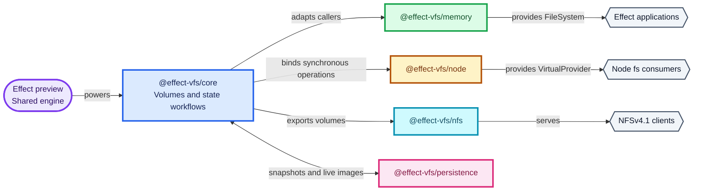

# Package feature map

The preview supplies the filesystem engine used by core. Core exposes shared volumes and adds portable state workflows and adapter integration. Package colors identify public ownership. Solid arrows describe capabilities or data flow. Dashed arrows describe requirements. These arrows complement the import dependencies in the [package dependency model](package-dependency-model.md "refines").

## Package overview

## Detailed feature map

Pill-shaped nodes identify Effect-provided capabilities, including the pinned preview. Rectangles identify community capabilities. Hexagons identify external consumers. Diamonds with dashed borders identify requirements. Package colors identify ownership.

Related public operations share feature nodes. Core also exposes engine capabilities through its own contracts. Transport and access are independent dimensions of an NFS export.

```mermaid
flowchart TB
  subgraph Preview["Effect preview · shared engine"]
    Owner(["Owner · atomic state"]) -->|authorizes| Caller(["Scoped callers<br/>Identity, permissions, root and cwd"])
    Caller -->|reads and writes| Files(["Files, directories and links<br/>Byte-preserving paths"])
    Files -->|opens| Handles(["Scoped handles<br/>Effect and synchronous APIs"])
    Guards(["Revision conditions<br/>Resource and work limits"]) -->|guards| Files
    Owner <-->|captures and restores| Capture(["Capture and restore"])
  end
  subgraph Core["@effect-vfs/core"]
    subgraph Access["Live access"]
      Volume["Shared volumes and callers"] -->|emits changes| Watches["Watch streams"]
      Fixtures["Validated fixtures"] -->|seeds| Volume
      Testing["Test layers and caller helpers"] -->|creates callers| Volume
    end
    subgraph State["Captured state"]
      Snapshot["Portable snapshots<br/>Byte and stream codecs"] -->|seeds| Overlay["Overlay workspaces"]
      Snapshot <-->|diffs and applies| Delta["Snapshot deltas<br/>Path-based three-way merge"]
      Overlay -->|captures final state and rename lineage| RenameMerge["Rename-aware overlay merge"]
      Snapshot -->|supplies common base| RenameMerge
      RenameMerge -->|emits version 1 delta| Delta
      Snapshot -->|queries| Search["Glob and content search"]
    end
    subgraph Integration["Integration"]
      Sync["Synchronous adapter binding"]
      Live["LiveVolume<br/>Image-store contract"]
      Registry["Live-volume registry<br/>Scoped owners by canonical key"] -->|opens and retains owners| Live
    end
    Volume <-->|captures and restores| Snapshot
    Volume -->|binds callers| Sync
    Live -->|opens| Volume
  end
  Owner -->|powers| Volume
  Capture -->|supplies state| Snapshot
  CodeMode["Private Code Mode"] -->|merges two retained runs| RenameMerge
  Handles -->|supplies sync APIs| Sync
  subgraph Memory["@effect-vfs/memory"]
    MemoryFS["MemoryFileSystem"]
    Transfer["TreeTransfer<br/>Bounded tree imports and exports"]
    Faults["FileSystemTesting<br/>Observe calls and inject failures"]
  end
  Volume -->|adapts callers| MemoryFS
  Volume <-->|imports and exports| Transfer
  Snapshot -->|exports| Transfer
  MemoryFS -->|provides| EffectFS(["Effect FileSystem"])
  Transfer <-->|transfers trees| EffectFS
  Faults -->|wraps implementations| EffectFS
  subgraph Node["@effect-vfs/node"]
    Provider["NodeVirtualProvider"]
    SyncRequirement{"Synchronous memory volume"} -.->|required by| Provider
  end
  Sync -->|binds operations| Provider
  Provider -->|implements sync and promise APIs| NodeFS{{"Node fs"}}
  NodeFS -->|mount routing enables| Mounted{{"Callbacks, descriptors and streams<br/>CJS and ESM loading"}}
  subgraph Persistence["@effect-vfs/persistence"]
    Checkpoint["CheckpointStore<br/>Named SQLite snapshots"]
    SQLite["SqliteLiveImageStore<br/>Memory-only durability"]
    R2["R2LiveImageStore<br/>Application-qualified durability"]
    PostgreSQL["PgLiveImageStore<br/>Memory-only durability"]
    D1["D1LiveImageStore<br/>1 MiB cap · memory-only<br/>Hosted qualification pending"]
    Protocol["Shared live-image protocol<br/>Generation, digest, bounds and freeze"]
    R2Client["R2Client service<br/>Supplied transport capability"] -.->|required by| R2
    SQLite -->|uses| Protocol
    R2 -->|uses| Protocol
    PostgreSQL -->|uses| Protocol
    D1 -->|uses| Protocol
  end
  Snapshot <-->|saves and loads| Checkpoint
  Live <-->|loads and commits images| SQLite
  Live <-->|loads and commits images| R2
  Live <-->|loads and commits images| PostgreSQL
  Live <-->|loads and commits images| D1
  SqlClient(["Effect SqlClient<br/>SQLite driver"]) -.->|required by| Checkpoint
  SqlClient -.->|dedicated client required by| SQLite
  PgClient(["Effect PgClient<br/>Dedicated single-connection client"]) -.->|reserved by| PostgreSQL
  D1Client(["Effect D1Client<br/>Plain primary-serving binding"]) -.->|required by| D1
  Digest(["Effect Digest"]) -.->|required by| Protocol
  subgraph NFS["@effect-vfs/nfs"]
    Server["NfsServer · one volume"]
    subgraph Profiles["Access profiles"]
      ReadOnly["Read-only<br/>Metadata, directories, links and reads"]
      Writable["Writable · experimental<br/>Mutations and COMMIT"]
    end
    subgraph Policies["Transport and identity"]
      Local["Local read-only setup · preview"]
      Network["Network setup · experimental<br/>AUTH_SYS mapping to callers"]
    end
    Durable{"Qualified storage<br/>Survives power loss"} -.->|required by| Writable
    Server -->|offers| ReadOnly
    Server -->|offers| Writable
    Local -->|configures| Server
    Network -->|configures| Server
  end
  Volume -->|exports| Server
  Socket(["Effect SocketServer<br/>TCP or UNIX socket"]) -->|transports requests| Server
  Live -.->|must meet durability requirement| Durable
  ReadOnly -->|serves| Clients{{"NFSv4.1 clients"}}
  Writable -->|serves| Clients
  classDef preview fill:#ede9fe,stroke:#7c3aed,color:#2e1065,stroke-width:3px
  classDef core fill:#dbeafe,stroke:#2563eb,color:#172554,stroke-width:3px
  classDef memory fill:#dcfce7,stroke:#16a34a,color:#14532d,stroke-width:3px
  classDef node fill:#fef3c7,stroke:#b45309,color:#78350f,stroke-width:3px
  classDef persistence fill:#fce7f3,stroke:#db2777,color:#831843,stroke-width:3px
  classDef nfs fill:#cffafe,stroke:#0891b2,color:#164e63,stroke-width:3px
  classDef external fill:#f1f5f9,stroke:#475569,color:#0f172a,stroke-width:2px
  classDef requirement fill:#fff7ed,stroke:#9a3412,color:#7c2d12,stroke-width:3px,stroke-dasharray:6 4
  class Owner,Caller,Files,Handles,Guards,Capture preview
  class Volume,Watches,Fixtures,Testing,Snapshot,Overlay,Delta,RenameMerge,Search,Sync,Live,Registry core
  class MemoryFS,Transfer,Faults memory
  class Provider node
  class Checkpoint,SQLite,R2,PostgreSQL,D1,Protocol,R2Client persistence
  class Server,ReadOnly,Writable,Local,Network nfs
  class CodeMode,EffectFS,NodeFS,Mounted,Socket,Clients,SqlClient,PgClient,D1Client,Digest external
  class SyncRequirement,Durable requirement
```

## Merge boundaries

Core owns the [rename-aware merge](../research/overlay-rename-merge.md). Its input is two process-local overlay captures and their common base. It returns a standard delta and one conflict per decision. The caller can apply the delta with the existing snapshot API. The [Code Mode example](codemode-example.md) uses the API for release handoffs.

## Integration qualifications

Node requires synchronous memory execution. All four live-image stores commit whole images before core publishes a mutation and use the same ownership and validation protocol. Applications supply each store's client through Effect layers. SQLite, PostgreSQL and D1 report `memory-only`; writable NFS requires at least `survives-power-loss`. Only an explicitly qualified R2 deployment may assert that stronger tier, with one gateway per image.

Each PostgreSQL owner needs its own dedicated single-connection client. Closing a store releases its reservation; replacement must also close the old client and build a fresh composition. D1 and R2 clients may be shared across distinct image keys, while each store keeps independent ownership state. D1 owner closure drains its pending native statements before handoff. Local workerd checks do not complete hosted D1 release qualification.

The registry shares complete owners within one process by canonical key; it does not coordinate independent processes or Workers. The [persistence ownership decision](../decisions/persistence-store-helpers.md "constrained by") owns the client, cancellation and schema rules. The [registry contract](../contracts/live-volume-registry.md "refined by") owns scope sharing and shutdown order.

The [system boundaries](system-boundaries.md "constrained by") describe responsibility ownership. The [implemented filesystem profile](../profiles/implemented-filesystem.md "refined by") records supported behavior and limits. The checked-in preview manifest identifies the upstream revision represented by the engine nodes.
