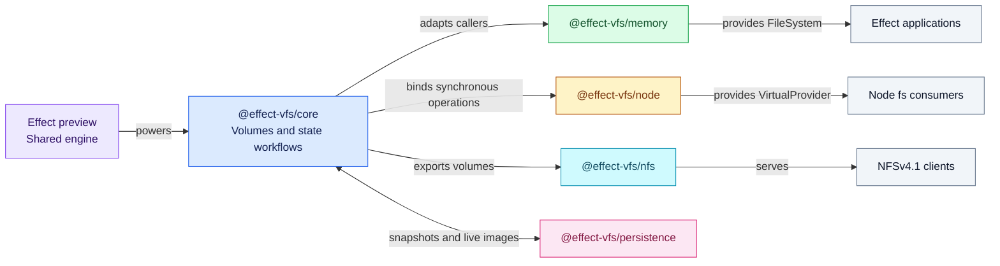

# Package feature map

The preview supplies the filesystem engine used by core. Core exposes shared volumes and adds portable state workflows and adapter integration. Package colors identify public ownership. Solid arrows describe capabilities or data flow. Dashed arrows describe requirements. These arrows complement the import dependencies in the [package dependency model](package-dependency-model.md "refines").

## Package overview

## Detailed feature map

Rounded nodes identify Effect-provided capabilities, including the pinned preview. Rectangular nodes identify community capabilities, requirements, and external consumers. Package colors identify ownership.

Related public operations share feature nodes. Core also exposes engine capabilities through its own contracts. Transport and access are independent dimensions of an NFS export.

```mermaid
flowchart TB
  subgraph Preview["Effect preview · shared engine"]
    Owner("Owner · atomic state") -->|authorizes| Caller("Scoped callers<br/>Identity, permissions, root and cwd")
    Caller -->|reads and writes| Files("Files, directories and links<br/>Byte-preserving paths")
    Files -->|opens| Handles("Scoped handles<br/>Effect and synchronous APIs")
    Guards("Revision conditions<br/>Resource and work limits") -->|guards| Files
    Owner <-->|captures and restores| Capture("Capture and restore")
  end
  subgraph Core["@effect-vfs/core"]
    subgraph Access["Live access"]
      Volume["Shared volumes and callers"] -->|emits changes| Watches["Watch streams"]
      Fixtures["Validated fixtures"] -->|seeds| Volume
      Testing["Test layers and caller helpers"] -->|creates callers| Volume
    end
    subgraph State["Captured state"]
      Snapshot["Portable snapshots<br/>Byte and stream codecs"] -->|seeds| Overlay["Overlay workspaces"]
      Snapshot <-->|diffs and applies| Delta["Snapshot deltas<br/>Apply and three-way merge"]
      Snapshot -->|queries| Search["Glob and content search"]
    end
    subgraph Integration["Integration"]
      Sync["Synchronous adapter binding"]
      Live["LiveVolume<br/>Image-store contract"]
    end
    Volume <-->|captures and restores| Snapshot
    Volume -->|binds callers| Sync
    Live -->|opens| Volume
  end
  Owner -->|powers| Volume
  Capture -->|supplies state| Snapshot
  Handles -->|supplies sync APIs| Sync
  subgraph Memory["@effect-vfs/memory"]
    MemoryFS["MemoryFileSystem"]
    Transfer["TreeTransfer<br/>Bounded tree imports and exports"]
    Faults["FileSystemTesting<br/>Observe calls and inject failures"]
  end
  Volume -->|adapts callers| MemoryFS
  Volume <-->|imports and exports| Transfer
  Snapshot -->|exports| Transfer
  MemoryFS -->|provides| EffectFS("Effect FileSystem")
  Transfer <-->|transfers trees| EffectFS
  Faults -->|wraps implementations| EffectFS
  subgraph Node["@effect-vfs/node"]
    Provider["NodeVirtualProvider"]
    SyncRequirement["Synchronous memory volume"] -.->|required by| Provider
  end
  Sync -->|binds operations| Provider
  Provider -->|implements sync and promise APIs| NodeFS["Node fs"]
  NodeFS -->|mount routing enables| Mounted["Callbacks, descriptors and streams<br/>CJS and ESM loading"]
  subgraph Persistence["@effect-vfs/persistence"]
    Checkpoint["CheckpointStore<br/>Named SQLite snapshots"]
    SQLite["SqliteLiveImageStore<br/>Memory-only durability"]
    R2["R2LiveImageStore<br/>Application-qualified durability"]
  end
  Snapshot <-->|saves and loads| Checkpoint
  Live <-->|loads and commits images| SQLite
  Live <-->|loads and commits images| R2
  subgraph NFS["@effect-vfs/nfs"]
    Server["NfsServer · one volume"]
    subgraph Profiles["Access profiles"]
      ReadOnly["Read-only<br/>Metadata, directories, links and reads"]
      Writable["Writable · experimental<br/>Mutations and COMMIT"]
    end
    subgraph Policies["Transport and identity"]
      Local["Local read-only setup · preview"]
      Network["Network setup · experimental<br/>AUTH_SYS mapping to callers"]
    end
    Durable["Qualified storage<br/>Survives power loss"] -.->|required by| Writable
    Server -->|offers| ReadOnly
    Server -->|offers| Writable
    Local -->|configures| Server
    Network -->|configures| Server
  end
  Volume -->|exports| Server
  Socket("Effect SocketServer<br/>TCP or UNIX socket") -->|transports requests| Server
  Live -.->|must meet durability requirement| Durable
  ReadOnly -->|serves| Clients["NFSv4.1 clients"]
  Writable -->|serves| Clients
  classDef preview fill:#ede9fe,stroke:#7c3aed,color:#2e1065
  classDef core fill:#dbeafe,stroke:#2563eb,color:#172554
  classDef memory fill:#dcfce7,stroke:#16a34a,color:#14532d
  classDef node fill:#fef3c7,stroke:#b45309,color:#78350f
  classDef persistence fill:#fce7f3,stroke:#db2777,color:#831843
  classDef nfs fill:#cffafe,stroke:#0891b2,color:#164e63
  classDef external fill:#f1f5f9,stroke:#64748b,color:#0f172a
  classDef requirement fill:#fff7ed,stroke:#9a3412,color:#7c2d12,stroke-dasharray:5 5
  class Owner,Caller,Files,Handles,Guards,Capture preview
  class Volume,Watches,Fixtures,Testing,Snapshot,Overlay,Delta,Search,Sync,Live core
  class MemoryFS,Transfer,Faults memory
  class Provider node
  class Checkpoint,SQLite,R2 persistence
  class Server,ReadOnly,Writable,Local,Network nfs
  class EffectFS,NodeFS,Mounted,Socket,Clients external
  class SyncRequirement,Durable requirement
```

## Integration qualifications

Node requires synchronous memory execution. Live volumes commit whole images on mutations. SQLite live storage declares `memory-only` durability. Writable NFS requires at least `survives-power-loss` durability. An R2 deployment needs application qualification and one gateway per image before declaring that durability.

The [system boundaries](system-boundaries.md "constrained by") describe responsibility ownership. The [implemented filesystem profile](../profiles/implemented-filesystem.md "refined by") records supported behavior and limits. The checked-in preview manifest identifies the upstream revision represented by the engine nodes.
