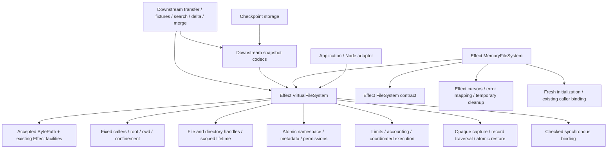

# Effect filesystem public contract draft

Effect owns two modules: `VirtualFileSystem` for the in-memory filesystem and its callers, and `MemoryFileSystem` for adaptation to Effect FileSystem. Community core is retired after the [staged implementation plan](minimal-effect-port.md "implements") completes.

The intended local contract is settled by the user's answers Q23–Q54 and the preceding ownership review. The completion decisions Q44–Q54 are recorded below. This document remains draft because implementation and upstream acceptance are pending; it is not a published compatibility promise. Stage 1 is the local baseline at `c3824294`.

## Ownership and dependencies



Only supported Effect exports connect downstream modules to the engine. Inode records, directory slots, draft installation and token registries remain private. Public inode numbers and optimistic revisions are observations, not access capabilities. Runtime validation schemas stay private. BytePath codecs are separately reviewed; snapshot wire schemas stay downstream.

The initial modules exclude watches, LiveVolume, durable commit hooks/stores, portable authenticated references and NFS. Overlays require a separate follow-up unless supported capture/restore is sufficient. No deferred feature is silently re-created through an extension callback or a private import.

## VirtualFileSystem declarations

This declaration block describes the agreed `effect/VirtualFileSystem` module. Brand keys are declaration-private. Target constructors, normalization and generated tagged-enum matching helpers remain public. The associated BytePath import is a target dependency, not an assertion that installed Effect 4.0.5 exports it.

```typescript
import type { BytePath } from "effect/BytePath"
import type * as ByteSize from "effect/ByteSize"
import type * as Cause from "effect/Cause"
import type * as Context from "effect/Context"
import type * as Data from "effect/Data"
import type * as Effect from "effect/Effect"
import type * as Layer from "effect/Layer"
import type * as Scope from "effect/Scope"
import type * as Stream from "effect/Stream"

declare const filesystemId: unique symbol
declare const callerId: unique symbol
declare const referenceId: unique symbol
declare const fileId: unique symbol
declare const directoryId: unique symbol
declare const captureId: unique symbol

export type PathInput = string | BytePath
export type Execution = "cooperative" | "sync"
export type FileKind = "directory" | "file" | "symlink"
export type SeekMode = "start" | "current" | "end" | "data" | "hole"

export interface Options {
  readonly execution?: Execution
  readonly maxEntries?: number
  readonly maxBytes?: ByteSize.ByteSize
  readonly maxFileBytes?: ByteSize.ByteSize
  readonly maxPathBytes?: ByteSize.ByteSize
  readonly maxPendingOperations?: number
}

export interface Limits {
  readonly maxEntries: number | undefined
  readonly maxBytes: ByteSize.ByteSize | undefined
  readonly maxFileBytes: ByteSize.ByteSize
  readonly maxPathBytes: ByteSize.ByteSize | undefined
  readonly maxPendingOperations: number
}

export interface Usage {
  readonly entries: number
  readonly usedBytes: bigint
}

export interface Identity {
  readonly uid: number
  readonly gid: number
  readonly groups: ReadonlyArray<number>
  readonly privileged: boolean
}

export interface CallerOptions {
  readonly identity?: Identity
  readonly umask?: number
}

export interface VirtualFileSystem {
  readonly [filesystemId]: true
  readonly limits: Limits
  readonly usage: Effect.Effect<Usage, VirtualFileSystemError>
  readonly caller: (options?: CallerOptions) => Effect.Effect<Caller, VirtualFileSystemError>
  readonly capture: Effect.Effect<Capture, VirtualFileSystemError>
}

export declare const VirtualFileSystem: Context.Service<VirtualFileSystem, VirtualFileSystem>
export declare const make: (options?: Options) => Effect.Effect<VirtualFileSystem, VirtualFileSystemError>
export declare const layer: (options?: Options) => Layer.Layer<VirtualFileSystem, VirtualFileSystemError>

export interface ObjectReference {
  readonly [referenceId]: true
}

export type Target =
  | {
    readonly _tag: "Path"
    readonly path: PathInput
    readonly relativeTo?: DirectoryHandle
    readonly followFinalSymlink?: boolean
  }
  | { readonly _tag: "Reference"; readonly reference: ObjectReference }
  | { readonly _tag: "Handle"; readonly handle: FileHandle | DirectoryHandle }

export type TargetInput = Target | PathInput | ObjectReference | FileHandle | DirectoryHandle
export type NameInput = string | Uint8Array
export interface Entry {
  readonly directory: Target
  readonly name: NameInput
}
export type EntryInput = Entry | PathInput | Extract<Target, { readonly _tag: "Path" }>

export declare const Target: Data.TaggedEnum.Constructor<Target> & {
  readonly of: (input: TargetInput) => Target
}
export declare const Entry: {
  (name: NameInput): (directory: TargetInput) => Entry
  (directory: TargetInput, name: NameInput): Entry
}
export declare const isTarget: (input: unknown) => input is Target
export declare const isEntry: (input: unknown) => input is Entry

export interface RestoreMetadata {
  readonly uid: number
  readonly gid: number
  readonly mode: number
  readonly atimeNs: bigint
  readonly mtimeNs: bigint
  readonly ctimeNs: bigint
  readonly birthtimeNs: bigint
}

export interface Metadata extends RestoreMetadata {
  readonly kind: FileKind
  readonly ino: bigint
  readonly nlink: number
  readonly size: bigint
  readonly revision: bigint
}

export interface ObjectObservation<A> {
  readonly value: A
  readonly revision: bigint
}
export interface DirectoryEntry {
  readonly name: Uint8Array
  readonly reference: ObjectReference
}
export interface DirectoryChange {
  readonly before: bigint
  readonly after: bigint
}
export interface ReferenceEntryResult {
  readonly reference: ObjectReference
  readonly directory: DirectoryChange
}
export type RenameReferenceResult =
  | { readonly _tag: "SameDirectory"; readonly directory: DirectoryChange }
  | {
    readonly _tag: "DifferentDirectories"
    readonly sourceDirectory: DirectoryChange
    readonly destinationDirectory: DirectoryChange
  }
export interface OpenEntryResult {
  readonly handle: FileHandle
  readonly reference: ObjectReference
  readonly created: boolean
  readonly directory: DirectoryChange
}

export interface OwnerUpdate {
  readonly uid?: number
  readonly gid?: number
}
export type TimeUpdate =
  | { readonly kind: "now" }
  | { readonly kind: "omit" }
  | { readonly kind: "value"; readonly nanoseconds: bigint }
export interface Times {
  readonly access: TimeUpdate
  readonly modification: TimeUpdate
}
export interface OpenOptions {
  readonly access: "read" | "write" | "readWrite"
  readonly create?: "never" | "ifMissing" | "exclusive"
  readonly mode?: number
  readonly append?: boolean
  readonly truncate?: boolean
}
export interface WriteFileOptions extends OpenOptions {
  readonly followFinalSymlink?: boolean
  readonly replaceFinalSymlink?: boolean
  readonly finalMode?: number
}
export interface OpenEntryOptions extends OpenOptions {
  readonly followFinalSymlink?: boolean
  readonly times?: Times
  readonly initialSize?: bigint
  readonly exactMode?: boolean
  readonly owner?: OwnerUpdate
  readonly expected?: ObjectReference | null
  readonly expectedChild?: {
    readonly reference: ObjectReference
    readonly revision: bigint
    readonly atimeNs: bigint
    readonly mtimeNs: bigint
  } | null
}
export interface MkdirOptions {
  readonly mode?: number
  readonly exactMode?: boolean
  readonly times?: Times
  readonly recursive?: boolean
}
export interface SymlinkOptions {
  readonly times?: Times
}
export interface RemoveOptions {
  readonly recursive?: boolean
  readonly force?: boolean
  readonly expected?: ObjectReference
}
export interface SetattrOptions {
  readonly size?: bigint
  readonly mode?: number
  readonly owner?: OwnerUpdate
  readonly times?: Times
  readonly expected?: { readonly revision: bigint }
}
export interface WalkOptions {
  readonly order?: "pre" | "post"
  readonly maxDepth?: number
  readonly maxEntries?: number
  readonly maxBytes?: ByteSize.ByteSize
}
export interface WalkEntry {
  readonly path: BytePath
  readonly name: Uint8Array
  readonly reference: ObjectReference
  readonly directory: ObjectReference
  readonly kind: FileKind
  readonly depth: number
}

export interface ReadResult {
  readonly bytes: Uint8Array
  readonly eof: boolean
}
export interface FileHandle {
  readonly [fileId]: true
  readonly read: (maximumBytes: number) => Effect.Effect<Uint8Array, VirtualFileSystemError>
  readonly pread: (maximumBytes: number, offset: bigint) => Effect.Effect<ReadResult, VirtualFileSystemError>
  readonly write: (bytes: Uint8Array) => Effect.Effect<number, VirtualFileSystemError>
  readonly pwrite: {
    (offset: bigint): (bytes: Uint8Array) => Effect.Effect<number, VirtualFileSystemError>
    (bytes: Uint8Array, offset: bigint): Effect.Effect<number, VirtualFileSystemError>
  }
  readonly seek: {
    (mode: SeekMode): (offset: bigint) => Effect.Effect<bigint, VirtualFileSystemError>
    (offset: bigint, mode: SeekMode): Effect.Effect<bigint, VirtualFileSystemError>
  }
  readonly truncate: (length: bigint) => Effect.Effect<void, VirtualFileSystemError>
  readonly stat: Effect.Effect<Metadata, VirtualFileSystemError>
  readonly sync: Effect.Effect<void, VirtualFileSystemError>
  readonly close: Effect.Effect<void, VirtualFileSystemError>
}
export interface DirectoryHandle {
  readonly [directoryId]: true
  readonly stat: Effect.Effect<Metadata, VirtualFileSystemError>
  readonly close: Effect.Effect<void, VirtualFileSystemError>
}

export interface Caller {
  readonly [callerId]: true
  readonly limits: Limits
  readonly root: Effect.Effect<ObjectReference, VirtualFileSystemError>
  readonly withRoot: (directory: TargetInput) => Effect.Effect<Caller, VirtualFileSystemError, Scope.Scope>
  readonly withDirectory: (directory: TargetInput) => Effect.Effect<Caller, VirtualFileSystemError, Scope.Scope>
  readonly lookup: (entry: EntryInput) => Effect.Effect<ObjectReference, VirtualFileSystemError>
  readonly parent: (directory: TargetInput) => Effect.Effect<ObjectReference, VirtualFileSystemError>
  readonly stat: (target: TargetInput) => Effect.Effect<Metadata, VirtualFileSystemError>
  readonly readDirectory: (
    target: TargetInput
  ) => Effect.Effect<ObjectObservation<ReadonlyArray<DirectoryEntry>>, VirtualFileSystemError>
  readonly walk: (target: TargetInput, options?: WalkOptions) => Stream.Stream<WalkEntry, VirtualFileSystemError>
  readonly readLink: (target: TargetInput) => Effect.Effect<Uint8Array, VirtualFileSystemError>
  readonly realPath: (target: TargetInput) => Effect.Effect<BytePath, VirtualFileSystemError>
  readonly access: (target: TargetInput, bits?: number) => Effect.Effect<number, VirtualFileSystemError>
  readonly readFile: (target: TargetInput) => Effect.Effect<Uint8Array, VirtualFileSystemError>
  readonly writeFile: {
    (
      bytes: Uint8Array,
      options: WriteFileOptions
    ): (entry: EntryInput) => Effect.Effect<ObjectReference, VirtualFileSystemError>
    (
      entry: EntryInput,
      bytes: Uint8Array,
      options: WriteFileOptions
    ): Effect.Effect<ObjectReference, VirtualFileSystemError>
  }
  readonly open: {
    (
      target: Target | PathInput | ObjectReference | FileHandle,
      options: OpenOptions
    ): Effect.Effect<FileHandle, VirtualFileSystemError, Scope.Scope>
    (entry: Entry, options: OpenEntryOptions): Effect.Effect<OpenEntryResult, VirtualFileSystemError, Scope.Scope>
  }
  readonly openDirectory: (target: TargetInput) => Effect.Effect<DirectoryHandle, VirtualFileSystemError, Scope.Scope>
  readonly mkdir: (
    entry: EntryInput,
    options?: MkdirOptions
  ) => Effect.Effect<ReferenceEntryResult, VirtualFileSystemError>
  readonly symlink: (
    target: PathInput,
    entry: EntryInput,
    options?: SymlinkOptions
  ) => Effect.Effect<ReferenceEntryResult, VirtualFileSystemError>
  readonly link: {
    (entry: EntryInput): (source: TargetInput) => Effect.Effect<ReferenceEntryResult, VirtualFileSystemError>
    (source: TargetInput, entry: EntryInput): Effect.Effect<ReferenceEntryResult, VirtualFileSystemError>
  }
  readonly unlink: (entry: EntryInput) => Effect.Effect<DirectoryChange, VirtualFileSystemError>
  readonly rmdir: (entry: EntryInput) => Effect.Effect<DirectoryChange, VirtualFileSystemError>
  readonly remove: {
    (
      entry: EntryInput,
      options?: RemoveOptions & { readonly force?: false }
    ): Effect.Effect<DirectoryChange, VirtualFileSystemError>
    (entry: EntryInput, options: RemoveOptions): Effect.Effect<DirectoryChange | undefined, VirtualFileSystemError>
  }
  readonly rename: {
    (to: EntryInput): (from: EntryInput) => Effect.Effect<RenameReferenceResult, VirtualFileSystemError>
    (from: EntryInput, to: EntryInput): Effect.Effect<RenameReferenceResult, VirtualFileSystemError>
  }
  readonly chmod: {
    (mode: number): (target: TargetInput) => Effect.Effect<void, VirtualFileSystemError>
    (target: TargetInput, mode: number): Effect.Effect<void, VirtualFileSystemError>
  }
  readonly chown: {
    (owner: OwnerUpdate): (target: TargetInput) => Effect.Effect<void, VirtualFileSystemError>
    (target: TargetInput, owner: OwnerUpdate): Effect.Effect<void, VirtualFileSystemError>
  }
  readonly utimes: {
    (times: Times): (target: TargetInput) => Effect.Effect<void, VirtualFileSystemError>
    (target: TargetInput, times: Times): Effect.Effect<void, VirtualFileSystemError>
  }
  readonly truncate: {
    (length: bigint): (target: TargetInput) => Effect.Effect<void, VirtualFileSystemError>
    (target: TargetInput, length: bigint): Effect.Effect<void, VirtualFileSystemError>
  }
  readonly setattr: {
    (attributes: SetattrOptions): (target: TargetInput) => Effect.Effect<void, VirtualFileSystemError>
    (target: TargetInput, attributes: SetattrOptions): Effect.Effect<void, VirtualFileSystemError>
  }
}

export interface Capture {
  readonly [captureId]: true
}
export type RestoreEntry =
  | { readonly kind: "directory"; readonly path: BytePath; readonly ino: bigint; readonly metadata: RestoreMetadata }
  | {
    readonly kind: "file"
    readonly path: BytePath
    readonly ino: bigint
    readonly metadata: RestoreMetadata
    readonly bytes: Uint8Array
  }
  | {
    readonly kind: "symlink"
    readonly path: BytePath
    readonly ino: bigint
    readonly metadata: RestoreMetadata
    readonly target: Uint8Array
  }
  | { readonly kind: "hardLink"; readonly path: BytePath; readonly targetIno: bigint }

export declare const entries: (capture: Capture) => Stream.Stream<RestoreEntry, VirtualFileSystemError>
export declare function restore(
  capture: Capture,
  options?: Options
): Effect.Effect<VirtualFileSystem, VirtualFileSystemError>
export declare function restore<E, R>(
  entries: Stream.Stream<RestoreEntry, E, R>,
  options?: Options
): Effect.Effect<VirtualFileSystem, E | VirtualFileSystemError, R>

export interface SynchronousHandle {
  readonly closed: boolean
  readonly directory: boolean
  readonly stat: () => Metadata
  readonly read: (length: number, position: bigint) => Uint8Array
  readonly write: (bytes: Uint8Array, position: bigint, append: boolean) => number
  readonly truncate: (length: bigint) => void
  readonly chmod: (mode: number) => void
  readonly chown: (owner: OwnerUpdate) => void
  readonly utimes: (times: Times) => void
  readonly sync: () => void
  readonly close: () => void
}
export interface SynchronousBinding {
  readonly stat: (target: TargetInput) => Metadata
  readonly readDirectory: (path: string) => ObjectObservation<ReadonlyArray<DirectoryEntry>>
  readonly readLink: (path: string) => Uint8Array
  readonly realPath: (path: string) => Uint8Array
  readonly access: (path: string, bits: number) => number
  readonly mkdir: (path: string, options?: MkdirOptions) => void
  readonly rmdir: (path: string) => void
  readonly unlink: (path: string) => void
  readonly rename: (from: string, to: string) => void
  readonly link: (source: TargetInput, destination: string) => void
  readonly symlink: (target: string, path: string) => void
  readonly chmod: (target: TargetInput, mode: number) => void
  readonly chown: (target: TargetInput, owner: OwnerUpdate) => void
  readonly utimes: (target: TargetInput, times: Times) => void
  readonly open: (path: string, options: OpenOptions, noFollow: boolean, directory: boolean) => SynchronousHandle
}
export declare const bindSynchronous: (
  caller: Caller
) => Effect.Effect<SynchronousBinding, VirtualFileSystemError, Scope.Scope>

export type ErrorCode =
  | "NotFound"
  | "AlreadyExists"
  | "NotEmpty"
  | "NotDirectory"
  | "AccessDenied"
  | "NotPermitted"
  | "InvalidHandle"
  | "ForeignHandle"
  | "InvalidReference"
  | "ForeignReference"
  | "StaleReference"
  | "ClosedCaller"
  | "InvalidArgument"
  | "InvalidPathEncoding"
  | "PathTooLong"
  | "NoSpace"
  | "IsDirectory"
  | "FileTooLarge"
  | "NoData"
  | "SymlinkLoop"
  | "UnrepresentableName"
  | "VolumeBusy"
  | "LimitExceeded"
  | "InvalidStructure"
export interface ErrorDetails {
  readonly code: ErrorCode
  readonly operation: string
  readonly path?: BytePath
  readonly field?: string
  readonly cause?: unknown
}
export interface VirtualFileSystemError extends Cause.YieldableError, Omit<ErrorDetails, "cause"> {
  readonly _tag: "VirtualFileSystemError"
}
export declare const VirtualFileSystemError: new(details: ErrorDetails) => VirtualFileSystemError
```

## Construction, authority and operation rules

`make` creates `/` only, inode 1, privileged uid/gid 0, mode 0755 and timestamps from the captured Clock. No constructor requires Crypto for private identity. Options cannot supply raw state, commit hooks, watch callbacks or a portable identity. Invalid options and unusable Clock values produce typed failures.

Root callers default to privileged uid/gid 0, empty supplementary groups and umask 022. Each caller copies and fixes its credentials; uid zero alone grants no privilege. Root callers and the owner need no Scope or public close. Derivation and open handles are independently scoped. Layers memoize within a layer graph; fresh construction or a fresh layer creates independent state. Caller authentication and user/group lookup stay in applications.

Paths and references use one operation implementation. Names are 1 to 255 bytes, contain no slash/NUL, and exclude `.` and `..`. Ordinary path operations preserve the existing path parsing, symlink, trailing-slash, search-permission and error-order contracts. A reference is accepted only if the owning registry issued it; a branded lookalike is not a capability. References and handles from another instance fail even if inode numbers match.

`withRoot` restricts paths, references and imported handles against the current namespace on each use. Derivation preserves credentials, umask and inherited restrictions. Current-directory and root identities survive rename; invalidated roots cannot be revived by replacement paths. Holding the filesystem owner grants the ability to mint callers and capture the whole filesystem; confinement is not a JavaScript sandbox.

Operation details retain the [regular-file I/O contract](../contracts/regular-file-io.md "constrained by"), [permissions and metadata](../contracts/permissions-and-metadata.md "constrained by") and [confined caller rules](../contracts/confined-callers.md "constrained by"). In particular:

| Operation              | Contract                                                                                                                                                                                                               |
| ---------------------- | ---------------------------------------------------------------------------------------------------------------------------------------------------------------------------------------------------------------------- |
| stat/readDirectory     | Metadata and directory observations include the revision sampled in the same coordinated observation. Live listings retain insertion order.                                                                            |
| walk                   | Root excluded; byte-name-sorted siblings, pre-order by default or post-order; one directory observation at a time, no snapshot or symlink following. Depth/entry/byte limits fail with LimitExceeded naming the field. |
| access                 | Returns the permitted subset of requested READ/WRITE/EXECUTE bits. MemoryFileSystem checks its requested bits and maps denial.                                                                                         |
| writeFile              | Required access mode; copies consumed input; returns written object identity; creation/truncation/append and final-symlink rules remain explicit.                                                                      |
| open                   | A target opens an existing file and rejects creation requests. An explicit entry can atomically create/open and returns whether it created the object. Existing path creation behavior stays supported.                |
| mkdir                  | Recursive creation is one atomic change; failure creates none. exactMode bypasses umask for an explicit mode without bypassing authority.                                                                              |
| link/symlink           | Hard links share file/symlink identity and contents; directory links fail. Symlink target bytes are not normalized or followed at creation.                                                                            |
| unlink/rmdir           | Remove one name; rmdir requires an empty directory. Open-file lifetime is independent of remaining names.                                                                                                              |
| remove                 | Force suppresses absence of the requested target. Recursive removal proceeds in separate identity-checked changes and can leave partial progress; it is not a transaction.                                             |
| rename                 | One coordinated namespace change; preserves object identity and returns relevant directory revisions.                                                                                                                  |
| setattr                | One atomic attributes change, including optimistic revision check. Size/owner/mode/times ordering preserves current permission and set-ID rules.                                                                       |
| expected/expectedChild | Identity mismatch and stale-observation failures stay distinguishable. Removing/replacing objects cannot redirect identity-checked cleanup to replacements.                                                            |

Default pending-operation limit is 64 plus one admitted slot. Entry/total-byte/path limits are absent unless supplied; file bytes have the existing 4,294,967,295-byte ceiling. Supplied byte limits use ByteSize; path limit must admit `/`; pending limit is positive. Usage samples entry and logical-byte counts together. Open-unlinked content stays charged until the last handle releases it. Symlink target bytes and file contents are charged once per inode; every non-root name consumes an entry.

Bytes are copied when an Effect consumes input, before retention. Returned buffers never expose internal mutable storage. Detached/shared mutable inputs retain the existing core rejection rules; MemoryFileSystem may copy a borrowed buffer into eligible storage before passing it to VFS. Private immutable storage may be shared across captures and independent restores without observable mutation.

## Capture and restoration

Only the owner captures. Callers and either adapter receive no route to whole-filesystem capture. Capture performs one consistent observation without changing access timestamps. The opaque value survives later writes and the source caller's lifetime. It retains only reachable filesystem contents semantically; unnamed open objects never appear in exported entries.

`entries` produces root first, then deterministic depth-first pre-order with siblings in raw byte-name order. It emits one primary record for each object, at its first encountered path, and hard-link alias records for its other names. File and symlink primary records carry metadata/content once. Each traversal returns independently owned path/name/content bytes. Traversal over a captured value does not need live filesystem ownership.

Every record path is an absolute canonical BytePath. Reject repeated separators, trailing separators outside root, dot/dot-dot components, NUL and overlong names. Restoration treats paths as namespace descriptions, never as requests to traverse symlinks. Symlink targets use their own raw-byte validation and may be relative, dangling or empty; they are not canonicalized.

Streamed restoration accepts records in arbitrary order. It stages data privately, charges limits as records arrive, and copies bytes before retention. Aliases and parents may precede their definitions. Reject duplicate paths/object definitions immediately when detectable. At completion require exactly one root directory at `/` with inode 1; every other parent must exist as a directory; every alias must target a defined file or symlink; directory aliases fail. Conflicting metadata cannot be supplied through aliases. No partial filesystem or caller is published on invalid input, stream failure or interruption.

Preserve the supplied inode numbers, uid/gid, permission mode and all four nanosecond timestamps. Derive file/symlink sizes and all link counts from validated contents. Inode numbers are bigint observations but constrained to 1 through Number.MAX_SAFE_INTEGER - 1. Timestamps retain the current range from -(10^128 - 1) through 10^128 - 1 nanoseconds. Modes remain permission/set-ID/sticky bits, without file-type bits.

New runtime references and handles are independent. Revisions restart at the existing initial revision, 1. Directory order starts in byte-name order regardless of input record order. Restoring a capture and restoring its entry stream must agree on contents and observations. Allocation resumes above the greatest restored inode; inaccessible deletion/allocation history is not part of the capture contract. A restore containing the maximum valid inode succeeds, but subsequent object allocation fails through the existing NoSpace error rather than wrapping, reusing a lower gap or colliding. Preserve current admission checks: hard-link creation also requires allocation capacity even though it shares an inode; this review does not introduce a special exhaustion exemption.

Restore never adds `/tmp`, rewrites timestamps, applies a creation umask to stored modes or imports source limits/execution policy. Destination options select those policies explicitly. Restore reads no Clock value to replace complete stored metadata; later operations use the destination Clock normally. A custom stream's typed error stays in the error channel; interruption remains interruption. Input-stream side effects are outside restoration's atomic-publication guarantee.

Streaming does not mean constant memory. Candidate state must be retained until validation completes. A record carries one complete file payload in the initial contract; chunked file-content records are not proposed. Logical quotas do not bound total heap, temporary allocations, arbitrary upstream producer work or retained captures. Downstream decoders retain encoded/decoded-input budgets.

## Handle and synchronous binding rules

VFS handles own independent cursors. Positional I/O leaves the cursor unchanged; append chooses EOF; truncate preserves the cursor. Open-unlinked files remain usable and charged until final release. File/directory acquisition requires Scope. All operations on logically closed handles fail; repeated explicit close fails and scope cleanup remains idempotent. Normal argument-validation precedence remains documented rather than promising one error for every invalid combination.

`bindSynchronous` borrows the selected Caller; it cannot silently construct root authority. It requires a constructor-qualified sync memory instance. Its scope owns binding lifetime and any opened handle scopes; it does not close the borrowed caller. A closed derived caller remains closed through the binding. Acquisition is an Effect; bound methods return ordinary values and throw VirtualFileSystemError for expected failures. Unexpected defects are not converted into success or expected filesystem errors.

Preflight rejects reentry and ineligible backends before resource acquisition or mutation. Synchronous ownership prevents scheduler yielding while a state transition is held. Finalizer releases requested during a transition drain before that transition returns. A failed synchronous call causes no later deferred mutation. Successful close cannot retain a live orphan. The binding offers no arbitrary-Effect runner or async store callback. The separate Node adapter owns Node flags, cursors and error conversion.

The binding retains the current native adapter's string-path subset and positioned handle operations. This initial binding is not a second general caller interface; ordinary callers retain byte-path access. Device/descriptor routing, native watches and loaders remain independently qualified Node work.

## MemoryFileSystem declarations

This block describes `effect/MemoryFileSystem`. It returns the existing Effect FileSystem interface rather than introducing a second service type.

```typescript
import type * as Effect from "effect/Effect"
import type * as FileSystem from "effect/FileSystem"
import type * as Layer from "effect/Layer"
import type * as PlatformError from "effect/PlatformError"
import type * as VirtualFileSystem from "./VirtualFileSystem.js"

export interface Options {
  readonly filesystem?: VirtualFileSystem.Options
  readonly caller?: VirtualFileSystem.CallerOptions
}
export declare const make: (options?: Options) => Effect.Effect<FileSystem.FileSystem, PlatformError.PlatformError>
export declare const bind: (
  caller: VirtualFileSystem.Caller
) => Effect.Effect<FileSystem.FileSystem, PlatformError.PlatformError>
export declare const layer: (options?: Options) => Layer.Layer<FileSystem.FileSystem, PlatformError.PlatformError>
```

`make` creates fresh filesystem state, initializes `/tmp` as mode 0755, uses Clock timestamps and defaults the convenience caller's umask to 0. Explicit caller options win. The VFS root defaults remain as specified above. Construction errors translate to PlatformError with FileSystem/make context. Layers share one constructed service within their memoized graph; fresh layers construct independently.

`bind` borrows an existing authentic caller and preserves its root, cwd, credentials and umask. It does not create `/tmp`, seed fixtures, alter metadata, acquire whole-filesystem authority or close the caller. Handles obtained through it have their own Scope lifetime and retain the caller's confinement. Binding rejects invalid or already-released callers through its typed PlatformError channel; no revocation or permission bypass is introduced.

The initial module exports no fixture constructors, watch-overflow guard, snapshot codec or storage constructor. A fixture package can construct through supported VFS operations or restoration, then bind the resulting caller.

### FileSystem compatibility matrix

The installed source reviewed is Effect 4.0.5. It is evidence for the matrix, not the eventual release pin. An inspected sibling source adds lstat, but neither inspected constructor derives glob. Before upstream acceptance, record one exact target source revision and repeat the complete member/options audit, including release-dependent additions.

| Member                                        | Required behavior                                                                                                                                                                                 |
| --------------------------------------------- | ------------------------------------------------------------------------------------------------------------------------------------------------------------------------------------------------- |
| access / exists                               | Respect readable/writable requests and existence semantics; preserve structured denial rather than misreporting absence.                                                                          |
| stat                                          | Follow final symlink, map metadata with exact bigint inode/link facts and representable Date timestamps.                                                                                          |
| lstat / typed listings                        | Include when required by the pinned target; inspect final symlink itself and return bare entry names/kinds. Do not simulate support with stat-following behavior.                                 |
| chmod / chown / utimes                        | Use selected caller authority; preserve mode, ownership and timestamp validation and error context.                                                                                               |
| link / symlink / readLink / realPath / rename | Preserve namespace and strict text conversion behavior, including trailing-slash rules and symbolic links.                                                                                        |
| makeDirectory                                 | Recursive/mode options; no partial recursive creation.                                                                                                                                            |
| readDirectory                                 | Sorted names; recursive output is relative to the requested root; no silent omission of unrepresentable names.                                                                                    |
| remove                                        | Recursive/force options and the existing partial-progress semantics; identity-safe cleanup.                                                                                                       |
| readFile / readFileString                     | Independently owned bytes; use the target FileSystem's string decoding semantics.                                                                                                                 |
| writeFile / writeFileString                   | Target flag/mode rules; default w and mode 0644; preserve the target's derived helpers.                                                                                                           |
| truncate                                      | Optional length defaults to zero, with validated extension/truncation.                                                                                                                            |
| copy                                          | Overwrite opt-in, preserveTimestamps option, no copy into self/descendant, existing partial-progress and ownership-safe rollback rules.                                                           |
| copyFile                                      | Retain its existing overwrite/same-inode behavior independently of copy.                                                                                                                          |
| open                                          | Scoped file; flags r, r+, w, wx, w+, wx+, a, ax, a+, ax+; default r, mode 0644; final noFollow with parent traversal intact.                                                                      |
| makeTempDirectory / makeTempFile              | Parent/prefix and file suffix validation, exclusive allocation and existing returned-path behavior. Default parent /tmp is relative to the selected caller's visible root.                        |
| Scoped temporary variants                     | Bounded, identity-safe, authority-limited namespace cleanup.                                                                                                                                      |
| stream / sink                                 | Target offsets, lengths, chunk sizes, flags, modes, cancellation and scoped-file behavior through the target's helpers.                                                                           |
| glob                                          | Root/exclude options, strict borrowed-caller errors and documented ordering/symlink/Unicode rules; supply a compatible implementation until the selected target provides one.                     |
| watch                                         | Fail when consumed with PlatformError reason Unknown, module FileSystem, method watch, description WatchUnsupported. No registration or onReady callback. Maintainer acceptance remains required. |

Use FileSystem.make for helpers it actually derives at the pinned revision: exists, string read/write, stream, sink and service branding in the installed source. Do not overwrite those derivations without a compatibility reason. Public inherited members and options added by a later baseline require an explicit owning test rather than a cast.

Metadata maps file/directory/symlink kinds and typed mode bits; dev/rdev are zero where represented. ino/nlink and owner facts are present. No allocated-block statistics or block-size guarantee is invented. VFS nanoseconds map to Date milliseconds; out-of-range dates fail InvalidData. File.Info has no ctime in the installed baseline. Strict UTF-8 conversion failures reject listings/targets rather than replacing bytes or silently dropping entries.

Effect File objects keep their own serialized cursor. Ordinary reads advance it; read/readAlloc with position do not. EOF is 0 or Option.none respectively. Non-append writes advance it; append writes at EOF retain current adapter-cursor behavior. Non-append truncate clamps it to the new length. Negative seek fails without changing it. All operations on closed files fail with BadResource, including seek; changing today's closed-seek 0n result needs a regression and release note. File.read input-buffer and file.write shared-buffer handling retain the target compatibility rules through copying.

Temporary namespace cleanup never deletes a replacement object and never widens caller authority. Caller closure, confinement, permission or identity changes may prevent deletion. Expected inability to remove a path can leave it behind; unexpected cleanup failures remain visible. Retry counts are private. This best-effort namespace guarantee does not weaken mandatory handle ownership release or successful-close orphan reclamation.

## Error and compatibility review

The agreed error family retains existing filesystem codes, adds InvalidStructure for restore and unifies walk's LimitExceeded into the same typed family. StorageRejected, OutcomeUnknown, VolumeUnavailable, image encoding/format, delta and store codes stay outside the initial Effect contract. The Effect error vocabulary is independent of the community VfsError schema or class.

The code remains a discriminator for expected failures. operation identifies the public operation. path is an owned BytePath when representable, field identifies an invalid option/record member, and cause retains underlying context. Restoration diagnostics should identify the offending record/field without retaining unlimited producer data. Record-index message formatting is an implementation detail; diagnostics identify the offending record where possible without making message text a compatibility contract. MemoryFileSystem maps these errors to the pinned PlatformError contract; native adapters map throwing failures separately.

### Changes from the current implementation

| Change                                                                       | Required follow-up                                                                                                     |
| ---------------------------------------------------------------------------- | ---------------------------------------------------------------------------------------------------------------------- |
| Engine-private capture becomes supported opaque capture plus content records | New ownership, ordering, validation and compatibility tests; no raw State export.                                      |
| Checked native binding accepts an existing caller                            | Preserve confinement and fixed credentials; qualify reentry/finalizer behavior again.                                  |
| Public validation schemas remain private in Effect                           | Downstream code imports semantic types and owns its format schemas. Existing community exports remain until migration. |
| Memory make/layer become functions; bind selects a caller                    | Publish migration examples; do not silently reinterpret existing call forms.                                           |
| Memory initialization uses Clock, not fixture epoch timestamps               | Constructor regression and documented migration difference. Restore continues preserving stored timestamps.            |
| Closed Effect-file seek fails instead of returning 0n                        | Explicit compatibility correction, test and release note.                                                              |
| One filesystem error family                                                  | Verify exact code/PlatformError mappings; keep producer failures and defects distinct.                                 |

## Agreed completion decisions Q44–Q54

The user accepted all recommendations in the final decision round:

| Decision                 | Agreed contract                                                                                                                                                                                                                |
| ------------------------ | ------------------------------------------------------------------------------------------------------------------------------------------------------------------------------------------------------------------------------ |
| Q44: public exports      | Keep make, restore, entries, bindSynchronous and the MemoryFileSystem make/bind/layer names. Retain Target constructors/of/matching helpers, Entry, isTarget and isEntry. Preserve existing Entry and timestamp-update shapes. |
| Q45: service and layers  | Include the VirtualFileSystem service tag and configurable layer. Layers memoize owners; selected callers remain explicit capabilities. MemoryFileSystem provides the existing FileSystem service.                             |
| Q46: constructor options | Nest MemoryFileSystem options under filesystem and caller. Binding an existing caller accepts neither construction-policy group.                                                                                               |
| Q47: restore metadata    | Require complete ownership, mode and all four timestamps. Downstream fixture loaders supply their own defaults.                                                                                                                |
| Q48: primary records     | First path in deterministic byte-name traversal supplies contents/metadata; later names are inode aliases. File and symlink aliases are supported, including empty symlink targets; directory aliases fail.                    |
| Q49: allocation          | Both restoration inputs resume above the greatest restored inode. Hidden allocator history is excluded. Exhaustion fails through the typed error channel, without wrap or collision.                                           |
| Q50: caller binding      | MemoryFileSystem.bind rejects invalid/closed callers immediately with PlatformError. Later caller closure still affects operations; binding neither owns nor extends caller lifetime.                                          |
| Q51: synchronous surface | Retain the current native operation set, string-path subset and positioned handles; bind the selected caller. Do not duplicate the whole caller interface.                                                                     |
| Q52: errors              | Use VirtualFileSystemError with retained applicable codes, InvalidStructure and LimitExceeded, operation and optional path/field/cause. Preserve producer errors and defects. Format/store errors remain downstream.           |
| Q53: precedence          | Preserve existing validation precedence. Closed operations cannot succeed, including the approved seek correction; no universal closed-handle-first rule is introduced.                                                        |
| Q54: upstream gate       | Settle the intended contract locally. Pin the Effect source revision and qualify its complete FileSystem surface, BytePath integration and concurrency requirements before accepting the upstream implementation.              |

## Dependent-decision audit

No additional local policy decision is required by Q44–Q54. Required follow-up work is verification against the pinned upstream source, declaration completeness and behavioral qualification. A demonstrated incompatibility or upstream-requested scope change returns to review rather than silently changing this contract.

In particular, inode allocation exhaustion uses the existing typed capacity behavior; record diagnostics do not commit to exact message text; layer sharing does not grant implicit caller authority; and borrowed adapters do not prolong caller lifetime. The exact upstream source baseline and maintainer acceptance remain explicit stage 3 prerequisites, not claims established by this draft.

## Draft validation

The two declaration blocks and a consumer exercising construction, entry creation, timestamp updates, both bindings and both restoration inputs compile with strict TypeScript against installed Effect 4.0.5. A temporary opaque BytePath declaration substitutes for the unavailable target import. This checks internal declaration consistency, not accepted upstream BytePath compatibility or runtime behavior. Source review retained the existing Entry and timestamp-update shapes. The OKF bundle validates with no findings or broken links.

## Acceptance evidence required before implementation is called compatible

- Compile contract declarations and consumer examples against the accepted Effect source. Test root/caller/handle authority and branded-type interoperability through public exports.
- Exercise all retained caller overloads, optimistic guards, permission/error precedence, byte ownership, hard links, unlinked lifetime and rejected-mutation atomicity.
- Compare direct-capture and streamed restoration across existing encoded snapshot fixtures, metadata/inode numbers, aliases, deterministic order and reset revisions. Prove invalid, interrupted and failing streams publish nothing.
- Exercise destination quota checks with aliases and out-of-order definitions, plus invalid graphs, unsafe IDs and path/timestamp boundaries.
- Run the shared FileSystem method/options contract and host comparison. Add the approved initialization and closed-seek regressions; retain cursor and temporary replacement tests.
- Qualify the checked binding with confined callers, closed scopes, reentry, scheduler hooks, failed operations, all releases and final-close orphan reclamation. Then run separate Node provider and mounted qualification as advertised.
- Prove supported engine imports exclude downstream format/storage/watch dependencies. Keep all runtime schemas and inode state private.

No runtime implementation, release metadata, PR update or upstream acceptance is performed by assembling this draft. Existing runtime documentation continues to describe the current packages until the later implementation stages land.
