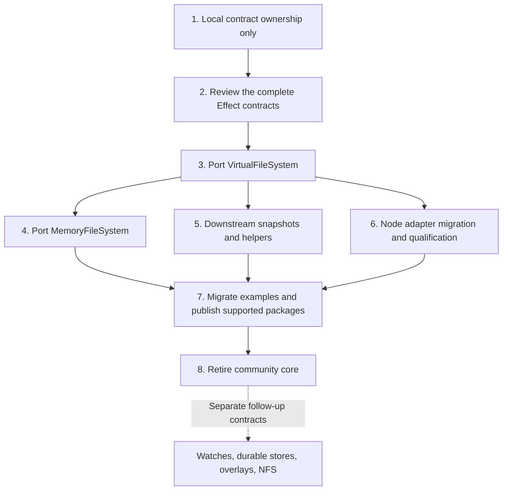

# Staged Effect filesystem implementation plan

Retire `@effect-vfs/core` in stages. Effect owns `VirtualFileSystem` and `MemoryFileSystem`; retained community packages use supported Effect exports. Preserve one filesystem implementation during migration. The first refactor changes contract ownership only.

The user agreed this direction during the architecture review on 22 October 2026. The module names are the requested destination, not evidence of upstream acceptance. This plan supersedes the earlier proposal to keep community core permanently and exclude the caller model from Effect. It does not change current runtime contracts or update external issues.

## Fix the ownership target

| Owner                       | Retained responsibilities                                                                                                                                                                                                                                                                                                     |
| --------------------------- | ----------------------------------------------------------------------------------------------------------------------------------------------------------------------------------------------------------------------------------------------------------------------------------------------------------------------------- |
| Effect `VirtualFileSystem`  | Memory filesystem construction, filesystem operations, caller model, permissions and confinement, root/current-directory derivation, handles, metadata, opaque instance-bound references, allocation/admission limits, consistent capture and safe restoration, opt-in synchronous execution and checked synchronous binding. |
| Effect `MemoryFileSystem`   | Adapt a selected caller to Effect `FileSystem`; translate errors, metadata, flags and file behavior. A convenience constructor can create a fresh filesystem and bind its default caller.                                                                                                                                     |
| Downstream snapshot package | Snapshot values and formats, encoding/decoding, hashing, decoding budgets and compatibility with existing encoded snapshots. Exact package name remains an implementation choice.                                                                                                                                             |
| Other downstream modules    | Tree transfer, filesystem testing, checkpoint storage, and search/delta/merge as their private-state dependencies are removed. Applications own authentication and mapping users to filesystem identities.                                                                                                                    |
| Deferred initial features   | Watches, LiveVolume, live durable stores, portable authenticated references and NFS. Overlays wait unless the supported capture/restore contract suffices without private state access.                                                                                                                                       |

Keep these guarantees:

- Preserve files, directories, symlinks, hard links, metadata, permissions, atomic namespace mutation, handle lifetime and open-unlinked files.
- Give each caller fixed credentials, supplementary groups, privilege and umask. Root/current-directory derivation preserves credentials and engine-enforced confinement.
- Keep inode records, directory slots, draft bookkeeping and identity representation private.
- Retain opaque instance-bound references and identity-checked cleanup. These references are not portable or serializable.
- Retain entry, total-byte, individual-file, path-length and pending-operation limits. Downstream features own their decoding/search budgets.
- Capture one consistent filesystem state. Restore independent contents, metadata, symlinks and hard-link relationships without transferring handles, callers or runtime identity.
- Make synchronous execution opt-in per filesystem. All its callers and handles share that mode. A checked binding accepts only qualified filesystem operations, never arbitrary Effects.
- Preserve the single-file engine default. A side module requires a concrete ownership or independently reusable abstraction justification.

The [current ownership model](../architecture/volume-caller-handle-model.md "contrasts with") describes implemented behavior, including community features still present during the transition. The [current package model](../architecture/package-dependency-model.md "contrasts with") remains accurate until migration changes the manifests.

## Follow the stage dependencies

Stages 4, 5 and 6 can proceed in parallel after their contracts are accepted. Stage 8 waits for every retained consumer to migrate and every deferred consumer to leave active builds/releases. Source review can use pinned upstream source; community publication requires a real tested Effect release.

## Stage 1: Make the local engine own its contracts

Local implementation now defines the capability contracts in engine.ts and retains explicit public declarations as compatibility views. Type/runtime import audits and compile-only previous-shape checks qualify ownership. This is local preparation, not upstream adoption or completion of later stages.

Deliver one behavior-preserving local refactor.

1. Inventory engine-owned operations, context, handles, targets/references, metadata, errors and limits against the existing community declarations.
2. Replace `EngineOperations = Omit<Caller, ...>` and other upward dependencies with engine-owned definitions. Keep those definitions private in this stage.
3. Make community contracts extend, project or adapt the engine-owned definitions. Preserve public names, brands, runtime schemas, declaration shapes and existing interoperability.
4. Separate engine-owned filesystem facts from community extension types conceptually. Keep watch, durability, snapshot and overlay behavior unchanged.
5. Extend dependency qualification to cover type ownership. The existing runtime audit erases types and cannot catch the upward `Caller` dependency.
6. Update the engine ownership map after the implementation matches it.

Primary files are `packages/core/src/internal/engine.ts`, `packages/core/src/VirtualFileSystem.ts`, and the public Caller, FileHandle, Target, Metadata and VfsError modules. Add no public minimal-engine export, duplicate runtime schema, generic transaction framework or mechanical per-operation file split.

Acceptance checks:

- Engine operation definitions no longer derive from the community Caller or facade. No runtime or type cycle reintroduces that direction.
- Community callers, adapters and existing consumers retain their public contracts and declaration compatibility.
- Runtime import isolation still passes. Core API contracts/type-checks and affected memory/Node declaration consumers compile.
- Engine, Execution, FileHandle, Confinement, filesystem behavior and affected adapter suites pass. Run watch/live/snapshot regressions where shared declarations or construction are affected.
- No feature is removed, no error vocabulary changes, and no execution policy or snapshot format changes.

Stop after this ownership refactor. Atomic-transition restructuring, public port contracts and feature migration belong to later changes.

## Stage 2: Review the complete Effect contracts

The [complete contract draft](effect-filesystem-contracts.md "specified by") records the locally agreed member-by-member contracts and Q44–Q54 completion decisions. Local contract review is complete; source qualification and upstream acceptance remain gates before stage 3 is accepted.

Specify construction, fixed callers, root/current-directory authority, path/reference/handle targets, identity-checked mutations, limits, errors and scoped lifetime. Specify snapshot capture/restore and the checked synchronous binding before consumers rely on them. Decide exact declarations during this review rather than copying the community facade wholesale.

For capture/restore, specify byte ownership, consistent observations, hard-link identity, metadata precision, limits and invalid-input rejection. Restore a fresh runtime identity. Keep format schemas, revision normalization and hashing downstream.

For the checked synchronous binding, specify eligibility, synchronous failure, reentry, scheduler behavior, close, finalizers and scope ownership. Prove there is no delayed mutation after synchronous failure and no successful close retaining an orphan. Preserve separate Effect and Node cursor semantics.

Resolve generic dependencies independently:

- Reuse Effect HashMap; do not restore the removed integer trie. Keep directory insertion-order mechanics private unless another concrete use justifies a generic collection.
- Use the separately reviewed BytePath value once accepted. Preserve filesystem path validation separately, including the difference between an empty byte value and an invalid filesystem path.
- Reuse Bytes, Glob and crypto-family facilities where the selected release provides the required contracts. Do not assume the historical next-minor manifest proves publication.
- Prove the cooperative FIFO scheduling requirement against the selected Effect concurrency facilities. Reuse an existing facility or resolve a demonstrated gap before upstream acceptance.

Acceptance requires maintainer agreement on ownership, exported contracts and the initial unsupported-watch profile. If agreement changes the selected scope, revise this plan explicitly. Do not preserve rejected features through private Effect imports or a second permanent engine.

## Stage 3: Port VirtualFileSystem to Effect

Port the selected implementation using the accepted contracts and a pinned Effect source baseline. Keep the existing community implementation available during the transition, but avoid independent feature development in two engines. Remove the temporary duplication when supported consumers switch.

Do not port watch hubs, durable commit/recovery policy, authenticated portable keys, image codecs or public overlay behavior. Retain atomic memory installation, caller authority, resource safety and the supported capture/restore and sync contracts.

Acceptance checks:

- Filesystem operations preserve byte names, hard links, symlinks, permissions, metadata and error ordering.
- Rooted callers enforce current namespace membership for references and handles, including rename, unlink and detached-root cases.
- Foreign/forged references fail; identity-checked cleanup preserves replacement objects.
- Rejected mutations preserve installed state and accounting. Open-unlinked files retain bytes until final close.
- Cooperative and synchronous modes pass their respective admission, cancellation, reentry and finalization checks.
- Capture/restore tests cover consistency, byte ownership, hard-link relationships, metadata and independent runtime resources.
- No deferred feature or community package is a transitive implementation dependency.

Reuse the existing behavioral corpus against the accepted implementation. Avoid tests that only mirror moved internal helpers.

## Stage 4: Port MemoryFileSystem to Effect

Bind the selected `VirtualFileSystem` caller. Keep filesystem semantics in that owner and compatibility translation in `MemoryFileSystem`.

Cover the complete selected FileSystem method/options profile: scoped files, positioned reads, independent cursor behavior, flags, noFollow, metadata conversion, errors, copy, temporary cleanup, streams, sinks and glob. Preserve fresh/shared construction distinctions. Specify default initialization explicitly; fresh MemoryFileSystem construction retains `/tmp` and convenience umask 0, with the explicitly approved change from epoch metadata to Clock timestamps. Binding an existing caller adds no `/tmp`; restoration preserves stored timestamps.

Keep the initial watch operation explicitly unsupported. The existing proposal fails on consumption with PlatformError reason Unknown, module FileSystem, method watch and description WatchUnsupported; maintainer review can settle its final contract. Unsupported behavior must not resemble a functioning empty stream.

Acceptance requires the shared FileSystem contract suite, the existing host comparison, copy/cleanup regressions and declaration checks. Qualify the selected package/runtime matrix separately. A browser bundle executed under Node does not prove browser runtime behavior.

## Stage 5: Move retained community features downstream

Create a focused snapshot package using only supported Effect exports. Preserve existing snapshot format compatibility with retained encoded fixtures and canonical encode/decode checks. Adapt capture data into the downstream model; do not export engine inode records to avoid the refactor.

Prove old snapshots decode and restore the same filesystem meaning. Preserve canonical ordering, metadata bounds, hard-link relationships and existing hashing/identity rules where the format requires them. If the supported capture contract cannot preserve compatibility, identify the exact gap before retiring core. Request the needed upstream capability or agree a versioned format migration; do not silently rewrite the format.

Then migrate:

- CheckpointStore to the snapshot package. Keep named snapshot storage separate from deferred live durable commits.
- TreeTransfer caller/host operations to Effect contracts; replace community fixture-entry types with downstream transfer/fixture types. Adapt its snapshot source separately.
- FileSystemTesting without importing community core transitively. It already operates on Effect FileSystem; its final package home remains open.
- Fixture loading and retained test helpers using supported construction/operations. Keep serialization formats downstream.
- Search, delta and merge away from private State. Keep their existing budgets and snapshot meaning. They may remain unmigrated while core still exists, but cannot retain private imports after core retirement.

Do not require overlays for initial package migration. Assess them against capture/restore in a separate refactor; defer them if preserving semantics needs additional contracts.

Acceptance requires no private Effect imports, no community-core dependency in migrated entry points, and snapshot/checkpoint/transfer/cleanup/search/delta/merge regressions appropriate to each moved module. Select exact package names and exports when creating those packages.

## Stage 6: Migrate the Node adapter

Replace the community SynchronousAdapter dependency with the accepted Effect checked binding. Do not reproduce `engineOf(volume)` outside Effect.

Preserve the separate Node handle adapter, per-open cursor, numeric flags, readonly behavior, metadata/error mapping and scope cleanup. Node watch remains unsupported. Sync opt-in is necessary but does not alone establish native compatibility.

Run provider/lifetime tests and mounted node:fs, descriptor, stream and loader qualification under the recorded Node baseline. Pin the executable and provider contract used for release qualification. Do not broaden arbitrary-byte routing claims beyond tested behavior.

Acceptance requires supported Effect exports only and the existing native qualification gates. Do not advertise crash durability for memory sync/datasync.

## Stage 7: Migrate consumers and release the supported subset

| Consumer          | Migration action                                                                                                                                                            |
| ----------------- | --------------------------------------------------------------------------------------------------------------------------------------------------------------------------- |
| virtual-build     | Migrate caller operations first. Adapt fixtures, snapshot tests and benchmark transfer/codec imports after Stage 5.                                                         |
| Basic agent-tools | Replace overlay construction with an independent restored working filesystem and a separate base reader, retaining rooted callers. Validate isolation and restart behavior. |
| Agent Code Mode   | Defer unchanged, or explicitly approve a reduced contract. Current results include overlay change summaries; ordinary capture is not a replacement for that result.         |
| demo-overlay      | Defer until overlays and watches return or the example is deliberately redesigned.                                                                                          |
| nfs-preview       | Defer with NFS.                                                                                                                                                             |
| demo-r2-nfs       | Defer with NFS and live durable stores.                                                                                                                                     |
| demo-alchemy      | Defer with live stores; also resolve its separately recorded Effect/Alchemy compatibility pause.                                                                            |
| Documentation     | Migrate examples, import paths, generated references and support tables alongside each stage.                                                                               |
| Scratchpad        | Exclude experiments from release acceptance; update or archive individual experiments as needed.                                                                            |

Release requirements:

- Use a published, tested Effect release with matching dependency minimums, lockfile, declarations and platform packages.
- Build and test migrated packages from clean consumer installs through public exports.
- Document deferred features and migration instructions. Breaking removals need an explicit package/version policy.
- Keep deferred packages on their last supported release or remove them from active workspace builds/releases deliberately. Do not treat exclusion as a successful migration.
- Decide the disposition of Code Mode and other feature-reduced examples before changing their behavior.

## Stage 8: Retire community core

Remove core only when every retained consumer uses supported Effect/downstream exports and every deferred consumer has an explicit disposition. Delete obsolete engine/adapter implementations, forwarding exports and dependency entries together with stale documentation.

Check active source imports, package manifests, generated declarations, build configuration, test projects and application entry points for community-core dependencies. Historical records and migration notes may retain its name; executable dependencies may not.

Acceptance requires clean installs, builds and appropriate runtime suites for the supported packages and examples. Preserve downstream snapshot compatibility. Record the last supported releases for deferred packages and a migration route for users before publishing removals.

## Track work without implying acceptance

Map implementation work to existing tracking before creating new tasks:

- #273 remains the umbrella; its older permanent-community-core and caller-exclusion scope needs reconciliation with this agreed direction.
- #308 owns the Effect VirtualFileSystem proposal and acceptance, including callers, capture/restore and the checked binding.
- #309 owns MemoryFileSystem adaptation and the selected FileSystem contract.
- #302 owns the execution/reentry/cleanup proof; #310 and #311 own the Node adapter and mounted qualification.
- #303 owns BytePath. Recheck its current upstream state and selected release before port implementation.
- #274, #275 and #278 retain consumer, runtime and migration/release work; align their scope when updating tracking.

The prior local extraction and collection/copy work are starting points, not new tasks to repeat. Exact PR splits for downstream relocation and core retirement can be created after Stage 1 establishes ownership.

This document records the plan only. It does not claim the new contracts, upstream port, downstream packages or native qualification are complete. Existing runtime documentation continues to describe the current implementation until each stage lands.
