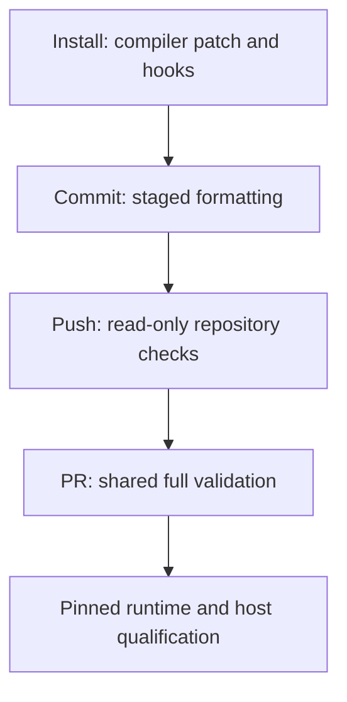

# Evidence and validation

Claims should be no broader than the check that supports them. A passing type consumer proves selected API composition, not filesystem behavior. A browser-target bundle proves bundling, not browser runtime operation. A focused regression proves its observable case, not complete standards conformance.

For a behavior change, identify the requirement or accepted decision, add a focused regression when appropriate, prove that the regression fails for the intended defect, repair narrowly, then run the relevant package and repository checks. Preserve structured errors and rejected-state invariants; do not validate behavior by parsing incidental error prose.

## Choose the validation level

The [repository validation policy](../decisions/repository-validation.md "constrains") owns the rules and exclusions.
Keep orchestration in one place and tests with the behavior they protect.

| Lifecycle             | Entry point                             | Responsibility                                                                                                       |
| --------------------- | --------------------------------------- | -------------------------------------------------------------------------------------------------------------------- |
| Install               | `prepare` and `postprepare`             | Patch the pinned Effect compiler integrations and install Husky hooks.                                               |
| Before commit         | `lint-staged`                           | Format staged source files. Do not build, execute suites or run type-aware lint against possibly stale declarations. |
| Before push           | `bun run check`                         | Check formatting, workspace/export inventory, dependency direction and runtime cycles without modifying files.       |
| Local full validation | `bun run validate`                      | Run the same ordered sequence as the main CI job.                                                                    |
| Pull request CI       | Frozen install, then `bun run validate` | Validate the published commit tree with the pinned toolchain. Hooks provide feedback; CI is authoritative.           |
| Runtime qualification | Dedicated CI jobs                       | Exercise native Node, host filesystem, protocol and persistence contracts under their required environments.         |
| Release               | Changesets workflow                     | Version and publish built packages after review and validation.                                                      |

## Run the checks once at their owning layer

`bun run validate --list` shows the shared sequence without executing it. Full validation runs fast repository checks,
build, lint, Effect diagnostics, type checking, tests, documentation, packed consumers and generated-reference verification.
Build before type-aware lint and consumer checks because packages export declarations from `dist`.

- `bun run check` is the fast read-only repository gate. `bun run lint` runs Oxlint only.
- `bun run lint:effects` discovers applicable workspaces and accepts a workspace directory or package name for a focused run.
- `bun run type-check` checks the typed Oxlint configuration, lint implementation and workspace type contracts. Preview qualification retains its scoped
  type, regeneration and standalone schema-consumer checks.
- `bun run test` runs the tooling contracts and the shared runtime suites. `bun run test:tooling` is the focused policy suite:
  isolated lint fixtures, package/export checks, architecture checks and the docs workspace's documentation tests.
- `bun run docs:check` validates metadata, regenerates the API reference, checks page ownership and compiles examples.
  Supported output assertions are executed. Docs build and dev commands do not implicitly run this validation suite.
- The packed-consumer phase imports published exports with TypeScript 5.9.3 and 7.0.2. Core's inference assertions live in
  its existing NodeNext consumer fixture. Those compiler versions are qualified separately, not as a continuous range.
- The final generated-reference check requires intended API page changes to be committed. While editing, review the
  generated diff and verify regeneration is repeatable before committing it.

Repository check implementations and their tests live under `tools/checks`. Lint implementations, accepted/rejected fixtures
and their runner live under `tools/oxlint`. Documentation checks and tests belong to the docs workspace. `scripts` retains
operator tooling, not another validation entrypoint. Do not retain inline self-tests inside a check runner or create a new
fixture directory when an existing consumer or contract suite owns that behavior.

Applications whose build script only invoked `tsc --noEmit` use their type-check task instead. A build task produces actual
artifacts. Scratchpad experiments remain type-checked, but an empty test registration does not count as a suite.

Library builds and lint tooling require unused-local and unused-parameter checks. Runtime namespaces remain supported;
`erasableSyntaxOnly` requires a separate compatibility decision. Retain regression tests, protocol baselines, package probes
and runtime fixtures when they protect a distinct contract. Similar filenames or small test files are not evidence that
coverage is disposable.

The main PR job uses Bun 1.4.4 and keeps benchmark correctness smoke checks after full validation. Privileged, credentialed
and live-service checks remain explicit operator commands or dedicated CI jobs; do not add them to Git hooks or generic
validation.

Separate jobs target Ubuntu 24.04. The host filesystem contract runs on Node 24.21.0. The direct Node provider, mounted filesystem, and TypeScript workbench jobs run on Node 26.11.1. Record the runtime each check exercised when citing its results.

Outside the main workflow, the NFS Linux mount gate is a separate workflow that runs on demand or when a pull request carries the `nfs-gate` label, and records the kernel client it ran against. The unprivileged pinned pynfs gate runs as its own workflow on pull requests that change the core, the NFS package, or the preview app, and fails on any difference from the classified known-failures file. The [NFS interoperability and fault evidence decision](../decisions/nfs/nfs-interoperability-evidence.md "refined by") fixes which NFS checks run where.

SQLite failure qualification has two separate gates. The opt-in hosted Linux workflow repeats process death, a real disk-full write, and injected SQLite VFS write and sync failures. A local UTM script forcibly stops a dedicated Linux guest between a provider write and recovery, retaining its virtual disk across boots. Both record the actual runtime and storage configuration. Neither a green hosted runner nor a VM hard stop proves physical power-loss durability; lost or reordered writes require a separate fault model, and a finite rollback-journal and temporary-file policy is still open.

Retain evidence only when its conclusion still changes present design, use, testing, or maintenance. Suitable retained evidence includes a reproducible regression probe, a measurement supporting an active limit, or an interoperability trace supporting a capability claim. Do not retain routine green logs, historical test counts, local timings, milestone chronology, or environment snapshots merely as history; Git already preserves those.

Record current caveats beside the claim they constrain. The [current validation ledger](../evidence/current-validation.md "summarized by") captures only cross-cutting conclusions that remain relevant.
